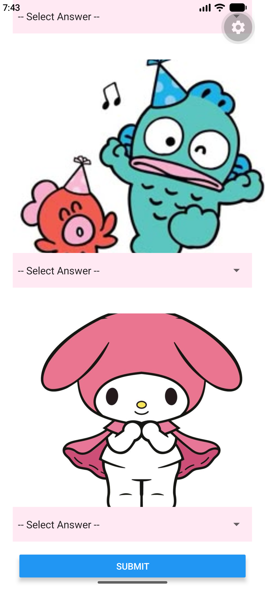
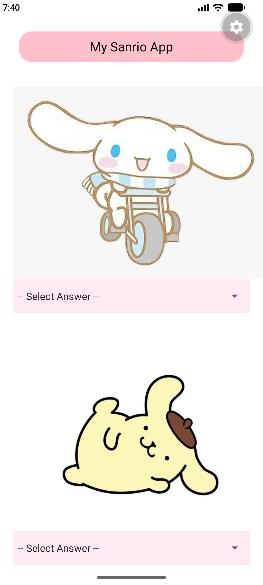

# App Name

A brief description of the mobile application and its purpose.

# Features Highlight

Highlight the features of your app and describe the concepts applied

# ScreenShots of App

# ScreenShots of App BEFORE applying Stylesheet changes
Screenshots top:   
Screenshots bottom:  

# ScreenShots of App AFTER applying Stylesheet changes
Screenshots top:   
Screenshots bottom:   
# Link to Demo Video with audible narration explaining styling changes with code reference
Demo Video Link:   https://drive.google.com/file/d/1Rbjc8nTMqQSKn5JVZrjFM3zXfkjDnqaF/view?usp=sharing